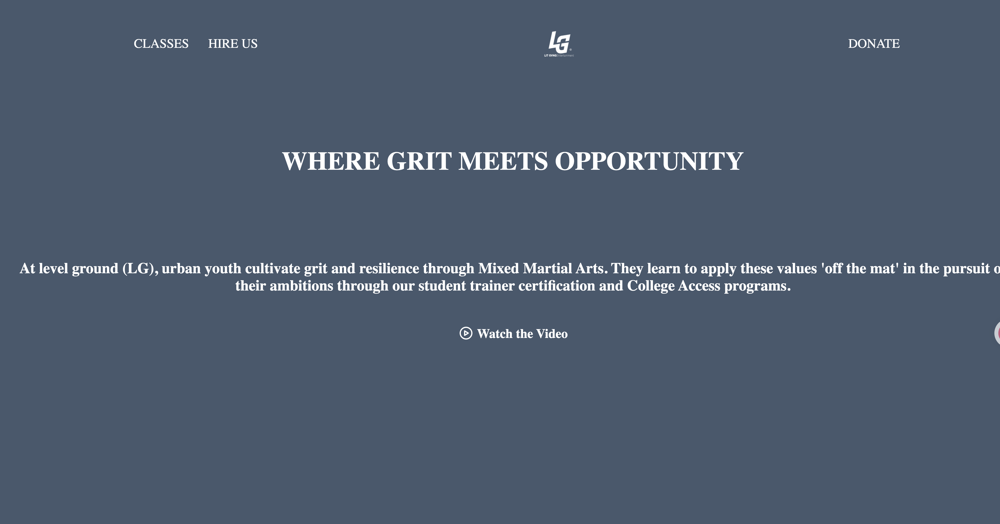
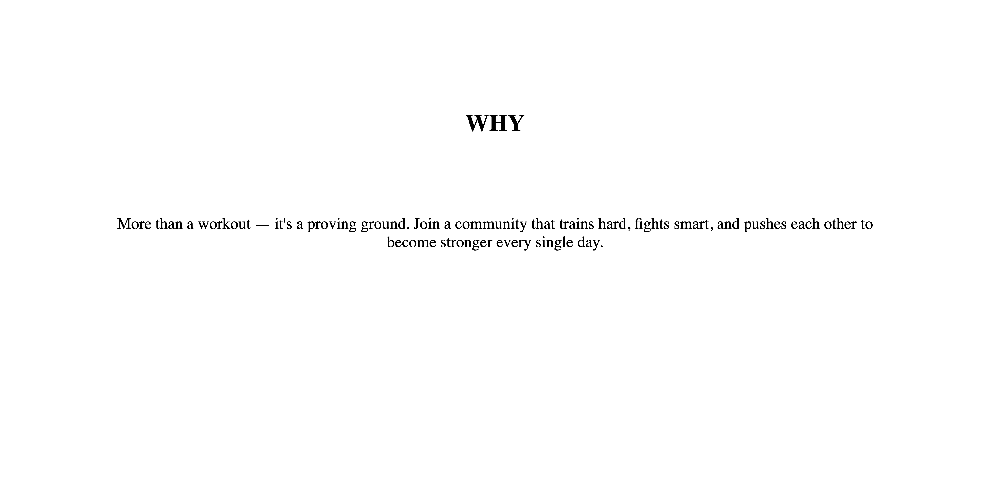
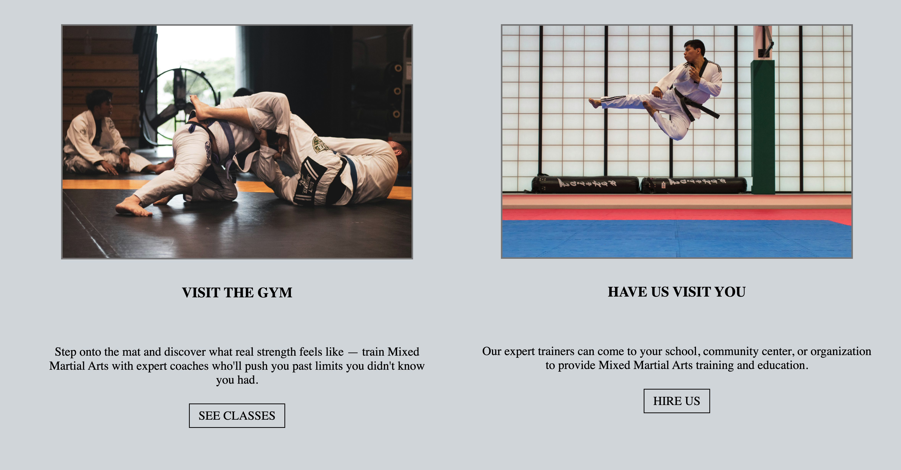

# Level Ground Martial Arts

A website for Level Ground Martial Arts, a martial arts school. Visitors can learn about the school, see what classes are offered, and find out how to get in touch.

## Demo

Live: [Live Demo](https://levelgroundmartial.netlify.app/)





## About the Project

I built this site to practice creating a clean, readable multi-section page using only HTML and CSS, with a focus on layout, typography, and responsive design.

## Features

- Clean, easy-to-read layout
- Responsive design that works on desktop and mobile
- Built without any frameworks or libraries

## Built With

- HTML5
- CSS3

## Getting Started

1. Clone the repo
   ```bash
   git clone https://github.com/sabrinalindev/Level-Ground-Martial-Arts.git
   cd Level-Ground-Martial-Arts
   ```
2. Open `index.html` in your browser

No build step or dependencies are required.

## Project Structure

```
Level-Ground-Martial-Arts/
├── index.html      # Main page
├── css/            # Stylesheets
└── img/            # Images
```

## What I Learned

- How to structure a webpage with semantic HTML
- How to style a page and build a responsive layout with CSS
- 【例如：how to use Flexbox or Grid】
- How to organize files in a small web project


